# Swing Light - a Kendama-inspired motion toy for Vespera

**CASA0014 Vespera coursework · lamp 30**

Spin it round and a column of light chases round the lamp. Toss it up and down and a row of light runs through it.

<p align="center">
  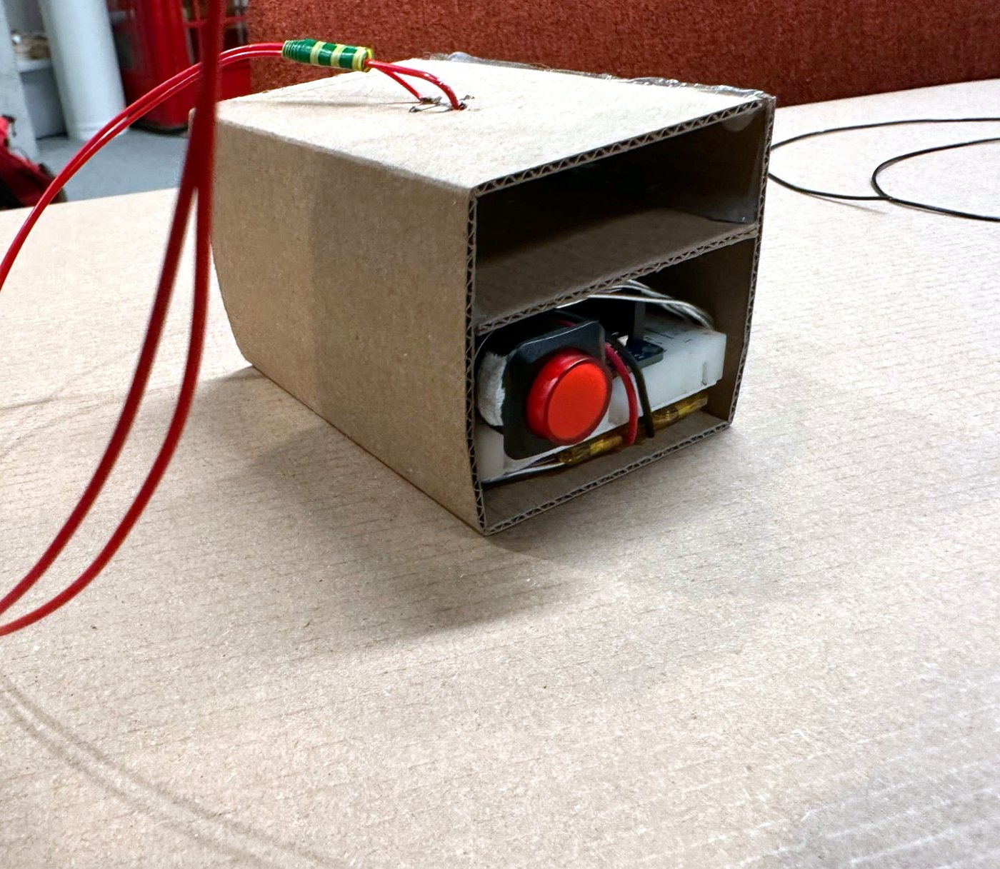
  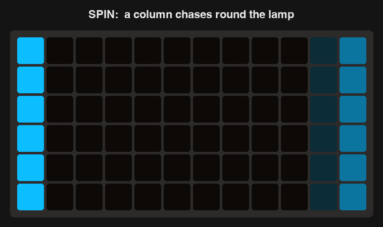
</p>

## Contents

- [Three ways to play](#three-ways-to-play)
- [Where the idea came from](#where-the-idea-came-from)
- [System overview](#system-overview)
- [Build log](#build-log)
- [Code at each stage](#code-at-each-stage)
- [Parts and wiring](#parts-and-wiring)
- [Try it yourself](#try-it-yourself)
- [Reflection](#reflection)
- [Sources](#sources)
- [Use of AI](#use-of-ai)

## Three ways to play

| | Spin | Toss | Still |
| --- | --- | --- | --- |
| **What you do** | swing the box round in a circle | bob or toss the box up and down | let it hang |
| **What the sensor sees** | gyroscope z turns faster than 120°/s | acceleration drops below 0.35g (in the air) or bounces a lot | almost no change, about 1g |
| **What the lamp does** | a cyan **column** chases round the 12 columns | a pink **row** runs through the 6 rows | the whole lamp glows dim warm white |

<p align="center">
  
  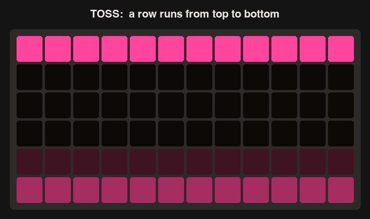
</p>

The faster you spin, the faster the column moves. The modes fade into each other instead of jumping.

## Where the idea came from

I first sketched a few ideas with different sensors (a button seesaw, a weight sensor, a colour sensor, a motion sensor), but they all felt too simple and not much fun to use.

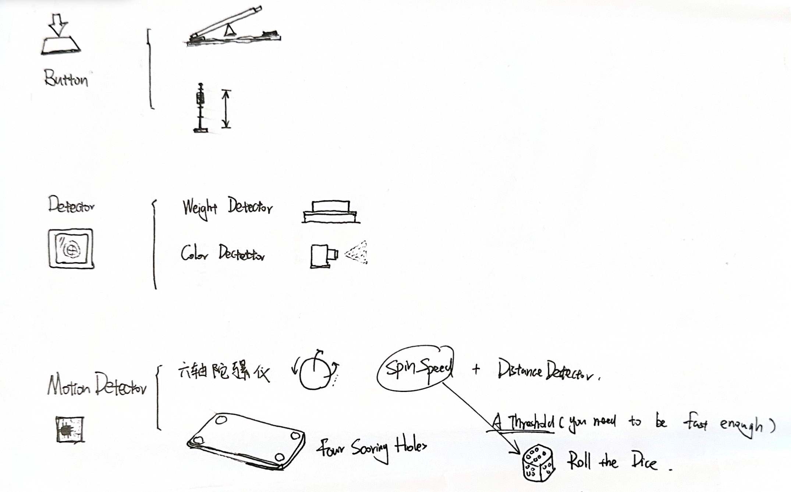

Then I thought of the **Kendama**, a Japanese toy where a ball on a string swings around a stick. I liked that you play it with your whole arm, so I made a box on a string with an accelerometer and gyroscope inside, and let the lamp react to how it moves.

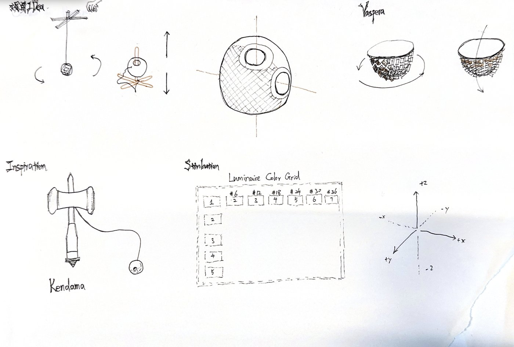

## System overview

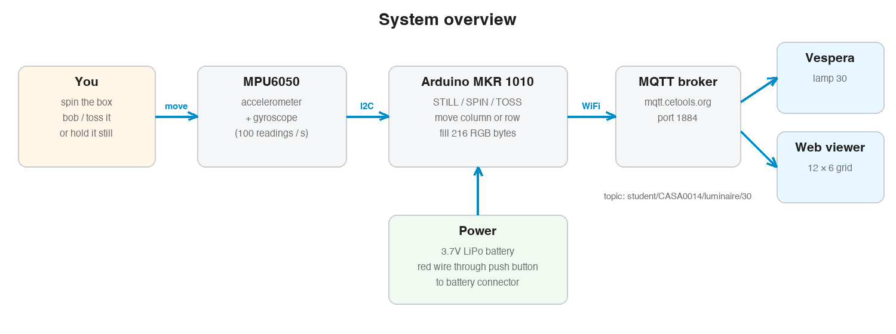

1. **Sensing**: the MPU6050 reads acceleration and rotation 100 times a second over I2C.
2. **Processing**: the Arduino decides STILL / SPIN / TOSS and fills the colours for all 72 LEDs (216 bytes).
3. **Network**: the colours are sent over WiFi to the MQTT broker 20 times a second.
4. **Output**: the Vespera lamp and the web viewer show them.

## Build log

### 1. Connect to the lamp in the lab

I used the workshop sketch to check the Arduino could connect to WiFi and MQTT and change lamp 30.

### 2. Get readings from the sensor

I soldered pins onto the MPU6050 and connected it with jumper cables, then checked it was found on the I2C bus and printed x, y, z readings.

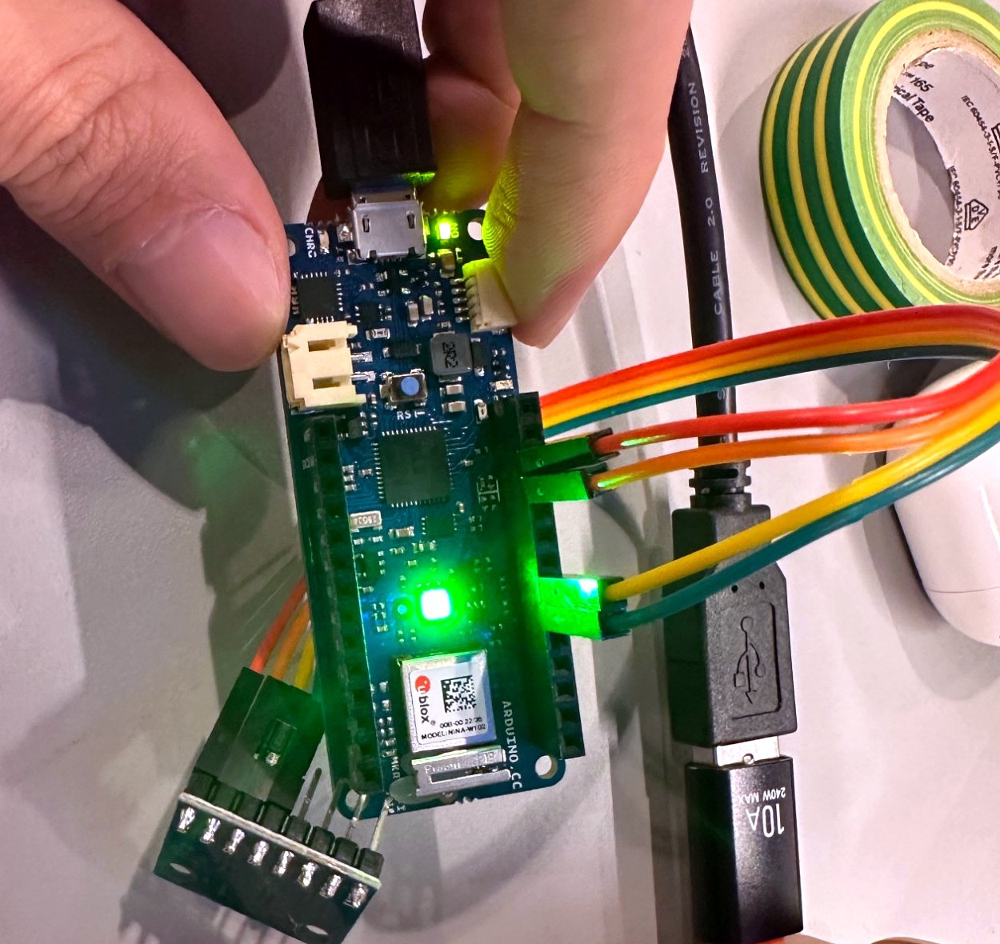

### 3. Understand the structure of Vespera's LED panels

To move a row or a column, I needed to know where each LED number sits. I lit 6 LEDs at a time, stepping round every 2 seconds. Each group of 6 turned out to be one vertical column.

<p align="center">
  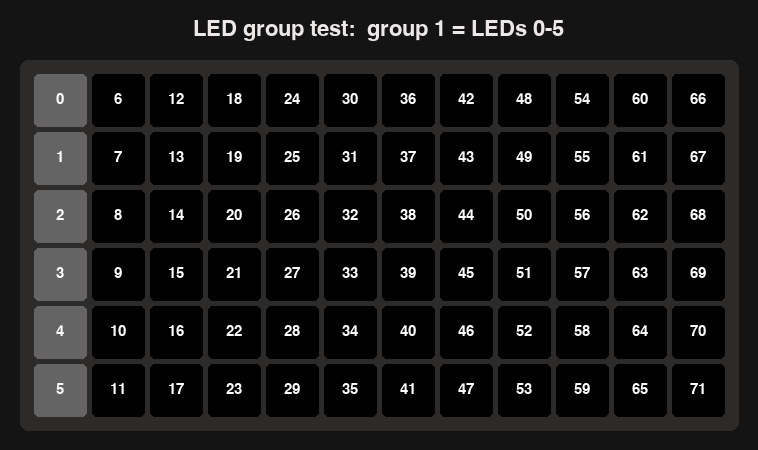
  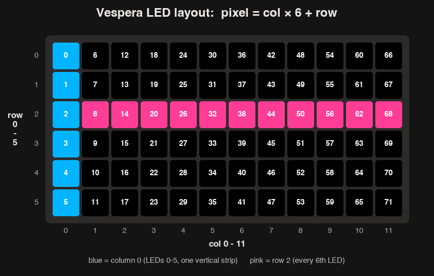
</p>

```
pixel = col × 6 + row        (col 0-11, row 0-5)
```

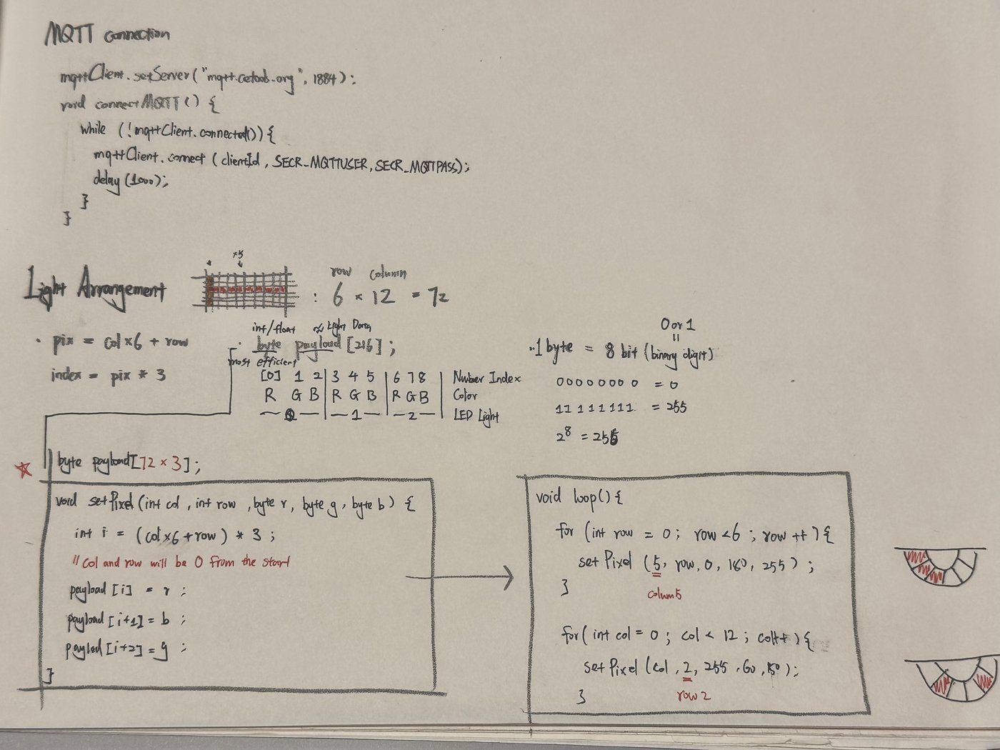

### 4. Change colour based on shake strength (abandoned)

Each reading is compared with the one before, then split into three levels:

```
change = √(dx² + dy² + dz²)
```


### 5. Cut the cable

Plugged into my laptop, nobody could really play with it. So I added a 3.7V LiPo battery, cut its red (+) wire and soldered the ends to a push button as an on/off switch.

<p align="center">
  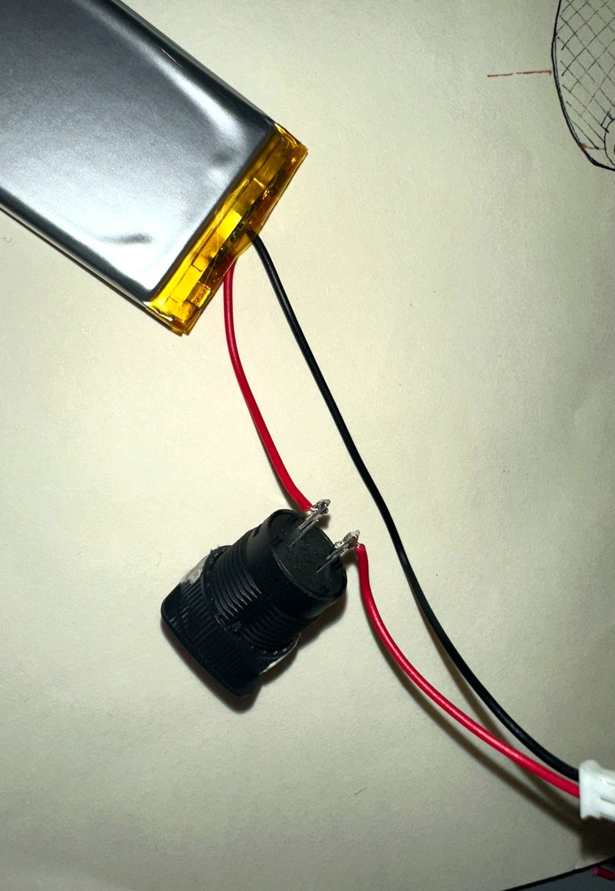
  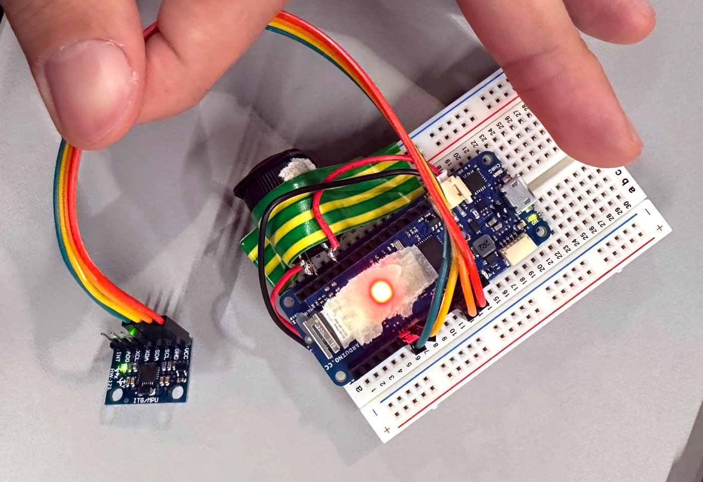
</p>

### 6. Make the sensor stable

**Problem:** on soft jumper cables the sensor wobbled whenever the box moved, so the readings were unstable.

**Fix:** I fixed everything on a breadboard with solid-core wires that lie flat, put the battery on the back with thick tape in between, and levelled the sensor with cardboard so its x, y, z axes read accurately.

<p align="center">
  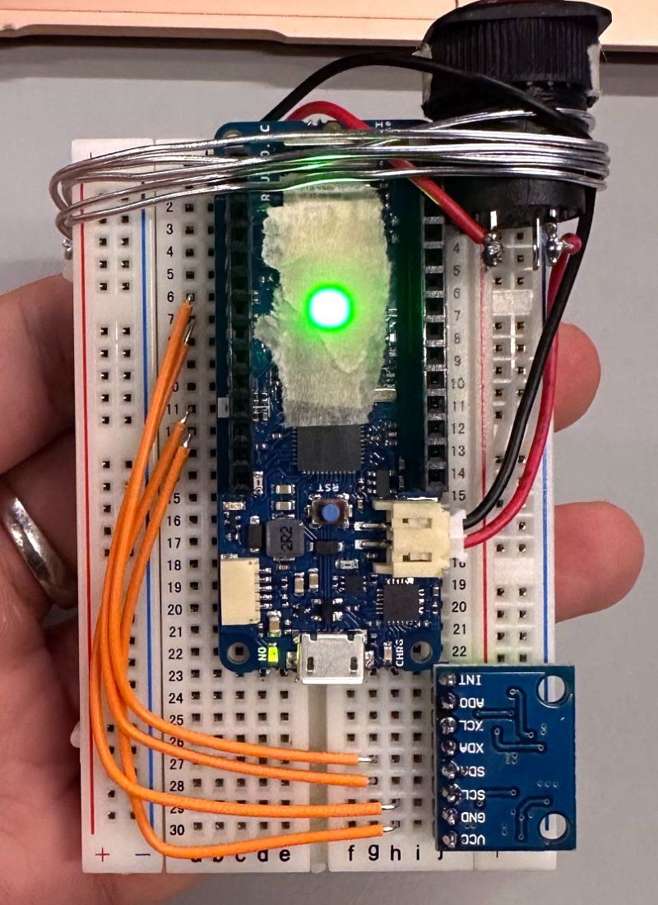
  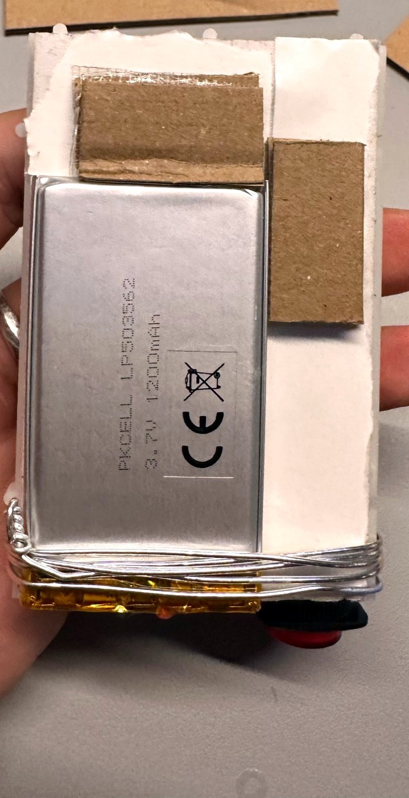
  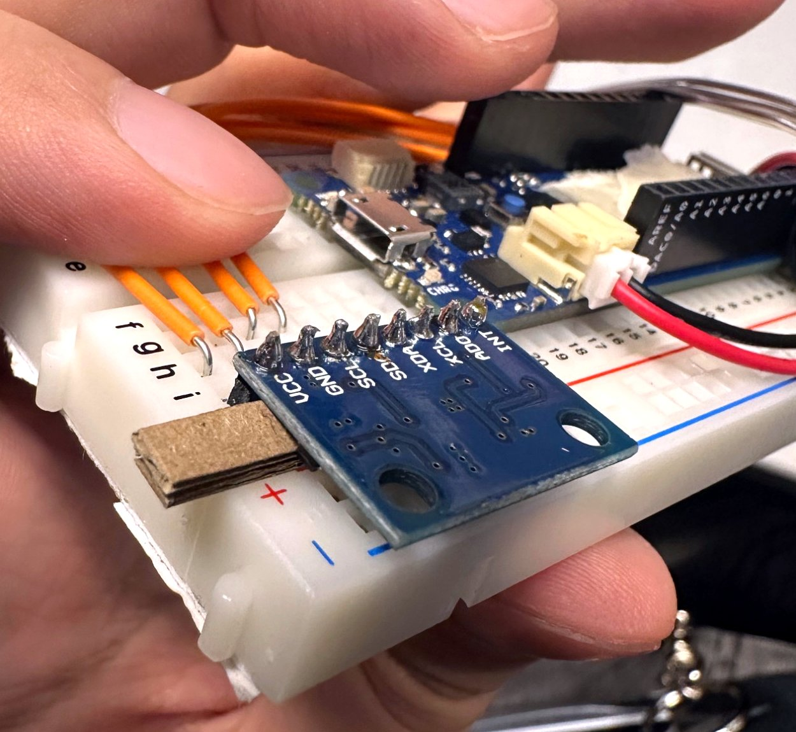
</p>

### 7. Add rows and columns

I dropped the stick-and-ball part of the Kendama. Instead, its two main movements each get a light pattern: columns for spinning, rows for tossing.

### 8. Build the box

Everything fits in a small cardboard box with a string tied to the top.

<p align="center">
  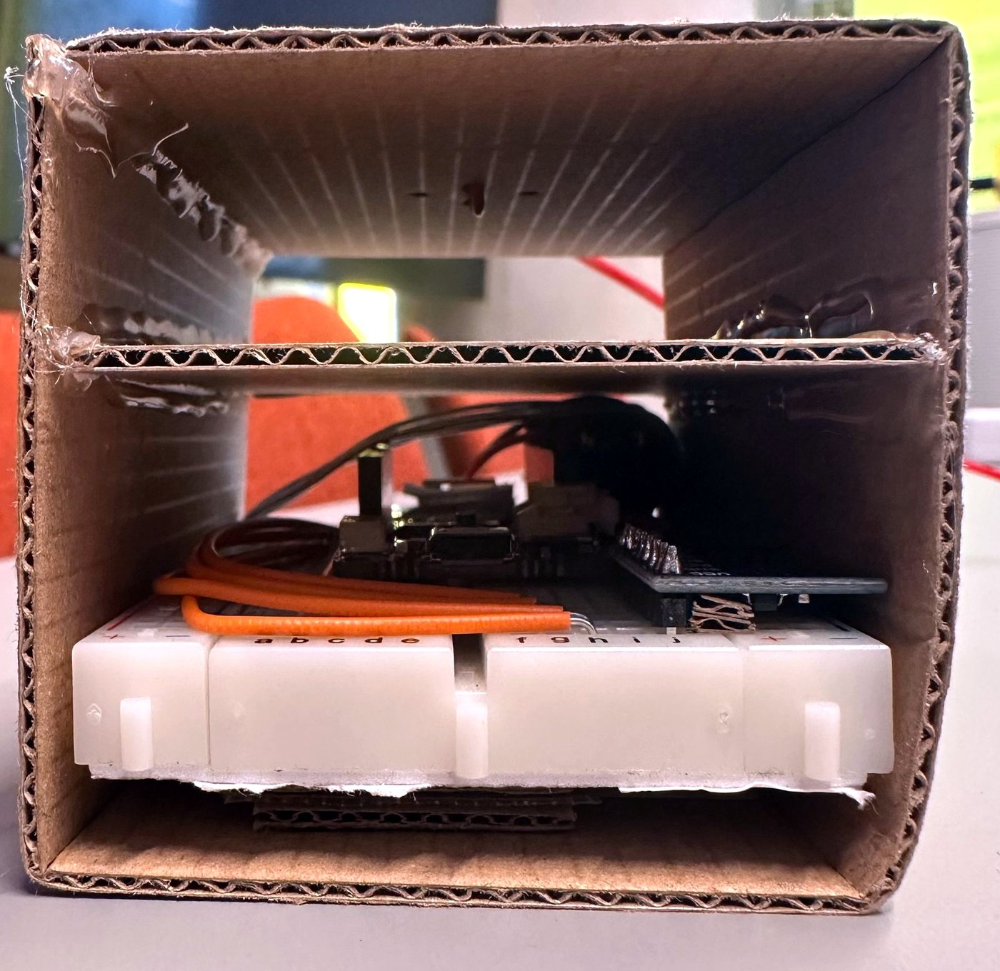
  
</p>

## Code at each stage

| Folder | What it checks | What it adds |
| --- | --- | --- |
| [`01.vespera_connection_test`](code/01.vespera_connection_test) | Can I change the lamp? | workshop sketch, set to lamp 30 |
| [`02.imu_wiring_test`](code/02.imu_wiring_test) | Is the sensor wired right? | I2C scan + x, y, z readings |
| [`03.shake_detection`](code/03.shake_detection) | Can I tell when it moves? | the `change` formula |
| [`04.led_group_map`](code/04.led_group_map) | Where is each LED? | found `pixel = col × 6 + row` |
| [`05.shake_strength_colours`](code/05.shake_strength_colours) | Can movement control the lamp? | 03's formula + 04's WiFi/MQTT code |
| [`06.button_switch_test`](code/06.button_switch_test) | Which button pins connect? | used to solder the battery switch |
| [`07.vespera_motion_toy`](code/07.vespera_motion_toy) | **Final version** | gyroscope, spin / toss / still, row and column chase, fades |

## Parts and wiring

| Part | Notes |
| --- | --- |
| Arduino MKR WiFi 1010 | |
| MPU6050 (accelerometer + gyroscope) | header pins soldered on |
| Mini breadboard + 4 solid-core wires | keeps the sensor still |
| 3.7V 1200mAh LiPo battery | plugs into the MKR battery connector |
| Push button | soldered into the battery's red wire |
| Cardboard box + string | |

| MPU6050 | Arduino |
| --- | --- |
| VCC | VCC |
| GND | GND |
| SCL | SCL |
| SDA | SDA |

Mount the sensor with its z axis pointing along the string, because the code uses gyroscope z to measure spinning.

## Try it yourself

1. **Build the breadboard**
   - Push the MKR WiFi 1010 and the MPU6050 into the breadboard.
   - Connect the sensor's VCC, GND, SCL and SDA to the same pins on the Arduino with 4 solid-core wires.
   - Cut the battery's red (+) wire and solder one end to each terminal of the push button. The black (−) wire stays as it is.
   - Plug the battery into the Arduino's battery connector and tape the battery to the back of the breadboard.
2. In the Arduino IDE, install **WiFiNINA**, **PubSubClient** and **Adafruit MPU6050** (Tools > Manage Libraries).
3. In `code/07.vespera_motion_toy/`, create `arduino_secrets.h` with your WiFi name and password and the MQTT username and password.
4. Change `lightId` to your own lamp number, then upload to the MKR WiFi 1010.
5. Open the Serial Monitor (115200 baud). Moving the box should print `STILL`, `SPIN` or `TOSS`.
6. Unplug the USB, connect the battery, press the button and play.

## Reflection

**What worked**
- Splitting the work into small test sketches meant I always knew which part was broken.
- The LED group test was the key step: once I knew `pixel = col × 6 + row`, rows and columns were easy.
- Fixing the sensor on a breadboard and levelling it made the readings much more stable than jumper cables.

**What I would change next time**
- Replace the cardboard box with a 3D-printed ball like in my first sketch, so it swings more like a real Kendama.
- Add a way to show the battery level.
- Tune the thresholds with more people, because everyone swings differently.

## Sources

- Vespera workshop sketch and WiFi / MQTT connection code by Duncan Wilson, [CASA0014](https://github.com/ucl-casa-ce/casa0014/tree/main/vespera). `code/01` is this sketch, and `connections.ino` and `RGBLED.ino` in `code/07` are adapted from it.
- LED layout and grid style from the CASA0014 [Vespera web viewer](https://github.com/ucl-casa-ce/casa0014/tree/main/vespera/web-viewer).
- [Adafruit MPU6050 library](https://github.com/adafruit/Adafruit_MPU6050).

## Use of AI

I first tried writing the code myself, then used Claude (Anthropic) as a tutor:

- **Explaining how things work**: the MPU6050, I2C, MQTT payloads, and how the Vespera LEDs are numbered.
- **Debugging**: finding why a sketch didn't compile or didn't behave as expected.
- **Checking my logic**: pointing out gaps, for example code that was written but never called.

To avoid relying on AI too much, I split the project into small steps (connect to the lamp, read the sensor, detect a shake, map the LEDs, and so on) and got each one working and understood before moving on. Each step is its own sketch in `code/`.

The idea, sketches, the first code, wiring, soldering, the enclosure and all testing on the real lamp are my own. AI also helped tidy the final code.
